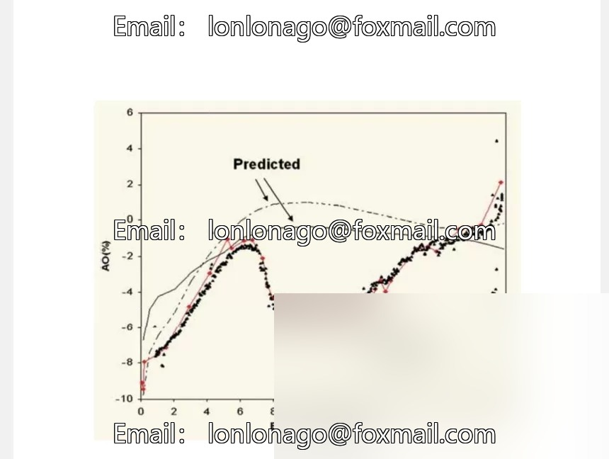
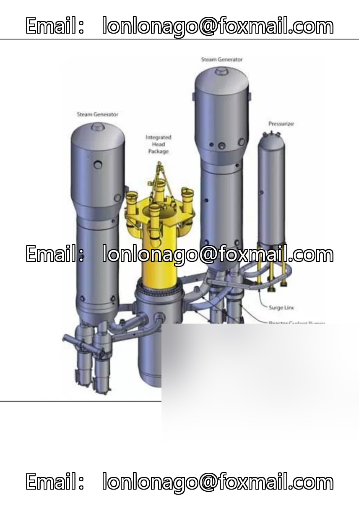

# Western House AP1000 construction pre-safety report

## Body

Wisthouse AP1000 Construction Safety Report (PCSR), (Westinghouse) AP1000 nuclear power plant, (Westinghouse) AP1000 nuclear power plant Construction Safety Report (PCSR),
UKP-GW-GL-793 Class 3 de-coded version
PDF , 4000 pages
AP1000 is the third-generation Pressurized Water Reactor power plant of Westinghouse, adopts modular design, single unit rated power is 1400 megawatts, design life is 60 years, has extremely high safety and reliability. This version is the Class 3 de-coded version approved by the UK regulatory authority (UKP), covers all-process safety requirements of the AP1000 nuclear power plant from design, construction to operation, is an important basis for nuclear power plant preliminary planning, construction, commissioning and operation.
14220

The document includes:
- Nuclear power plant design and safety analysis
- Pre-construction safety assessment (PCSR)
- Design details of critical systems (such as steam generators, reactor pressure vessels, safety injection systems, etc.)
- Safety operating guidelines
- Regulatory requirements and compliance
- Engineering implementation process and quality control

Suitable for reference for practitioners, engineers, scientific researchers, university and school teachers and related professional study.

This is the Westinghouse AP1000 nuclear power plant pre-construction safety report, covering design and safety analysis, pre-construction safety assessment, key system details, safety operational guidelines, regulatory compliance, and engineering implementation processes; it is a Class 3 declassified version approved by UK regulators.

<!-- AI_ENRICHED -->

## Images

## Payment

Here is a pay link on Stripe ( https://buy.stripe.com/3cs8yP7sY87d0vu9AB ). Please contact me lonlonago@foxmail.com after funding $89, and I will send you a complete data files , thank you!

